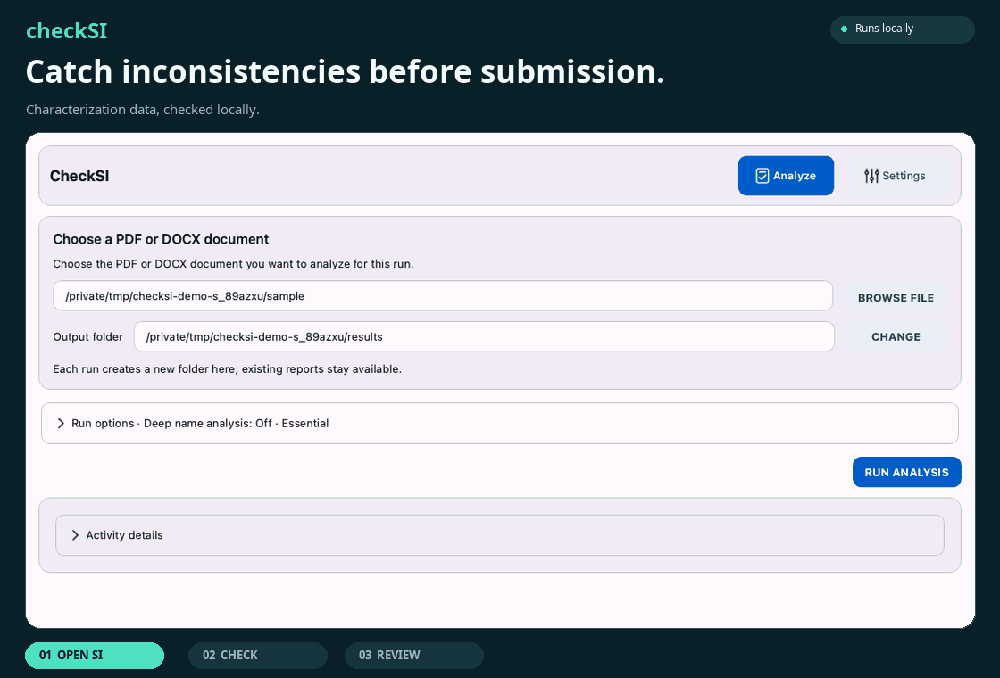

# checkSI

[](https://github.com/aelashkin/CheckSI/blob/main/LICENSE)
[](https://www.python.org/)
[](https://doi.org/10.26434/chemrxiv.15011545/v1)

**Computer-assisted checking of characterization data before submission.** checkSI reads supporting information and manuscripts in text-based PDF or DOCX format, extracts supported compound descriptions, and flags incomplete or inconsistent reporting across NMR, high-resolution mass spectrometry (HRMS) and elemental analysis.

## At a glance

[](https://github.com/aelashkin/CheckSI/blob/main/docs/usage.md)

## What it checks

- **Reporting conventions:** spectral headers, precision, signal counts, multiplicities and coupling notation.
- **Consistency:** agreement among reported NMR, HRMS and elemental-analysis fields where comparable.
- **Optional structure checks:** local name-to-structure conversion compares derived formulas and expected NMR signal counts with reported data.
- **Optional DP5q:** compatibility of a proposed structure with reported ¹³C shifts; the score is advisory.

The [article](https://doi.org/10.26434/chemrxiv.15011545/v1) reports manually confirmed inconsistencies in 188 of 2,572 recognized descriptions across 83 published documents. This describes that evaluation, not exhaustive recognition. See [analysis boundaries](https://github.com/aelashkin/CheckSI/blob/main/docs/analysis.md).

## Get started

[Install checkSI](https://github.com/aelashkin/CheckSI/blob/main/docs/installation.md), then follow the [desktop or command-line workflow](https://github.com/aelashkin/CheckSI/blob/main/docs/usage.md). Runs produce readable findings and structured results, with optional PDF, annotated-source and spreadsheet exports. [Reports](https://github.com/aelashkin/CheckSI/blob/main/docs/reports.md) explains each output; [agent usage](https://github.com/aelashkin/CheckSI/blob/main/docs/agent-usage.md) covers automation.

## Privacy and limitations

Analysis, name conversion, DP5q and report generation run locally. Runtime analysis sends no names or documents to a web resolver and downloads no models. Installation requires dependencies or a prepared local bundle.

Recognition and structure checks have a bounded scope. Findings support human review; a clean report or high compatibility score cannot establish identity. Assessment coverage, findings and export completeness are separate. Unsupported or missed descriptions still need manual inspection.

## Authors

Pavel Sakharov\* (a), Andrew Elashkin (b), and Mark Gandelman (a, c).

(a) Schulich Faculty of Chemistry, Technion – Israel Institute of Technology, Haifa 3200009, Israel.

(b) Taub Faculty of Computer Science, Technion – Israel Institute of Technology, Haifa 3200009, Israel.

(c) The Resnick Sustainability Center for Catalysis, Technion – Israel Institute of Technology, Haifa 3200009, Israel.

\* Corresponding author: [Pavel Sakharov](mailto:pavelpas@campus.technion.ac.il).

## Citation

Cite the [ChemRxiv preprint](https://doi.org/10.26434/chemrxiv.15011545/v1), posted November 2, 2026. GitHub's **Cite this repository** uses [CITATION.cff](https://github.com/aelashkin/CheckSI/blob/main/CITATION.cff), which also records software version 0.4.0.

<details>
<summary>BibTeX citation</summary>

```bibtex
@article{sakharov2026checksi,
  author  = {Sakharov, Pavel and Elashkin, Andrew and Gandelman, Mark},
  title   = {{checkSI}: Computer-Assisted Pre-Submission Checking of Characterization Data for Organic Compounds},
  journal = {ChemRxiv},
  year    = {2026},
  doi     = {10.26434/chemrxiv.15011545/v1},
  url     = {https://doi.org/10.26434/chemrxiv.15011545/v1}
}
```

</details>

## License and references

Code: [MIT License](https://github.com/aelashkin/CheckSI/blob/main/LICENSE). Bundled models and fonts retain their [own terms and notices](https://github.com/aelashkin/CheckSI/blob/main/docs/licensing.md). Cite the [methods and software](https://github.com/aelashkin/CheckSI/blob/main/docs/references.md) your results depend on separately.

## Further reading

[Configuration](https://github.com/aelashkin/CheckSI/blob/main/docs/configuration.md) · [Message guide](https://github.com/aelashkin/CheckSI/blob/main/docs/usage.md#message-guide) · [Development](https://github.com/aelashkin/CheckSI/blob/main/docs/development.md) · [Platform evidence](https://github.com/aelashkin/CheckSI/blob/main/docs/platform-compatibility.md) · [Scientific evidence](https://github.com/aelashkin/CheckSI/blob/main/docs/chemistry-verification.md)
