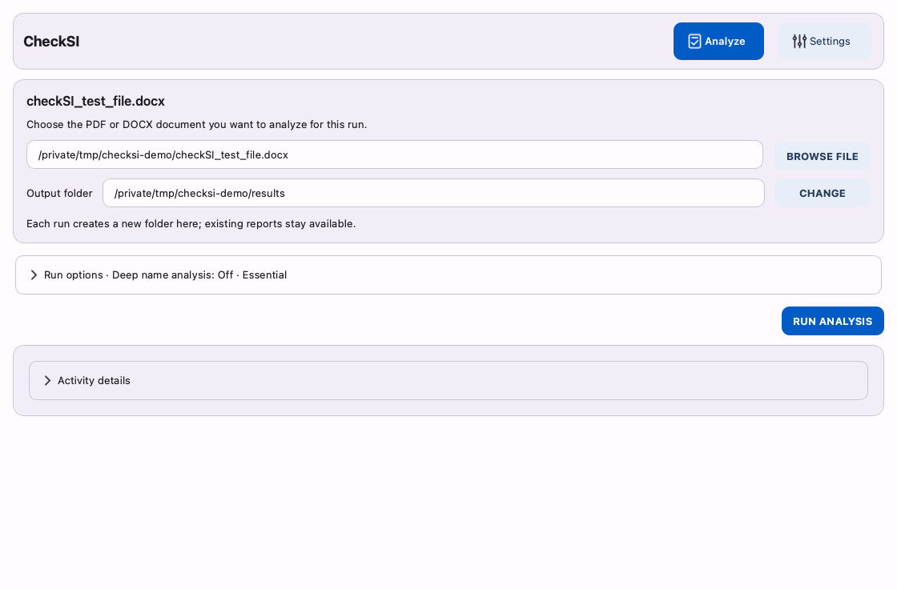
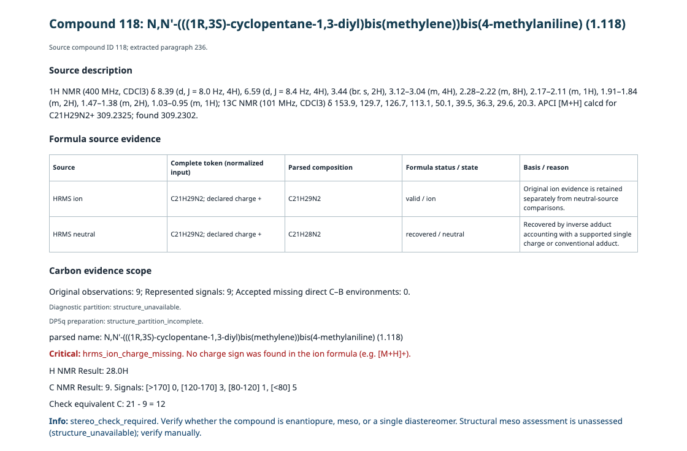

# Usage

Start with [installation](installation.md); source-checkout commands below run from the repository root. CLI and GUI share one analysis/reporting runner. [Configuration](configuration.md) owns settings; [reports](reports.md) owns artifacts, statuses and exit codes.

## CLI run and cancellation

1. Choose a PDF/DOCX, or try the bundled demonstration input:

   ```sh
   uv run --locked checksi --config-file settings.toml run data/checkSI_test_file.docx --output-dir results
   ```

2. Read `assessment_status`, finding counts and `export_status` separately in the run summary. The sample intentionally demonstrates issues; incomplete assessment exits **3**.
3. Open the `report_html` path. Each run has its own folder containing `findings.html`, `results.json` and optional exports. See [output meanings](reports.md#artifacts-and-ownership).

The example uses repository settings without saving defaults. `--config-file FILE` selects TOML before the subcommand. `checksi run --help` lists run flags, including repeatable `--override KEY=VALUE`; overrides affect one run without saving.

Ctrl+C requests cancellation; POSIX `SIGTERM`/`SIGHUP` do likewise, preserving previously ignored signals. Further signals repeat the cooperative request. Only completed compounds contribute findings. Cancellation before export suppresses reports; during export, completed artifacts remain and automatic opening is suppressed. Extraction/rendering may finish their current operation. DOCX conversion and model workers have bounded termination/cleanup; abrupt OS or supervisor death and filesystem failures can leave private temporary files.

Both streams use UTF-8. Progress/phase counts go to stderr; logs/summary go to stdout. Counts are phase-local, not an overall percentage. Configuration-load errors/notices use stderr so `config view` stdout remains JSON.

## GUI Analyze

1. Install the [GUI extra](installation.md#source-checkout), then launch:

   ```sh
   uv run --locked checksi-gui --config-file settings.toml
   ```

2. Select **Browse File** and choose a PDF/DOCX; try `data/checkSI_test_file.docx` for the demonstration shown here. Choose an output parent.
3. Review **Run options**, then select **Run Analysis**. Compact options apply immediately; the runner copies confirmed settings at start.

[](assets/readme/analyze.png)

4. Read the summary's assessment, findings and export warnings separately. A prior result stays identified while another input is selected or run.
5. Select **Open Findings** for HTML or **Other formats** for available exports. Inspect each description beside its messages.

[](assets/readme/findings.png)

Demonstration data; deep name analysis and DP5q are off.

Progress, elapsed time and **Cancel** remain visible in Settings. Activity details preserve manual scrolling and offer **Jump to latest**/**Copy details**. Ctrl+O (Command+O on macOS) selects a document; Tab/Space operate controls. Closing requests cancellation and waits for analysis/status work.

## Message guide

The guide explains diagnostic codes through demonstration descriptions and selected output.

1. In a source checkout, open `docs/checkSI_message_guide.html` directly in a browser.
2. Without a checkout, open the [guide file on GitHub](https://github.com/aelashkin/CheckSI/blob/main/docs/checkSI_message_guide.html), select **Download raw file**, then open the saved HTML in a browser. GitHub's source view does not render the guide.
3. Filter by message code, select a section and expand an example to compare its description and findings.

The records are demonstrations, not experimental data. Optional web fonts have local fallbacks; the guide's examples are embedded.

## Settings and diagnostic search

Settings edits are drafts. **Confirm Changes** validates and applies them to future runs without writing a file. Leaving for Analyze with unconfirmed edits offers **Confirm Changes**, **Discard Changes** or **Keep Editing**. Discard restores the confirmed session, including after invalid edits. Active checks retain their starting settings.

**Save User Defaults** confirms/saves settings for startup. **Export Config** confirms/writes a chosen TOML; **Import Config** loads a draft. Neither changes startup defaults. **Restore Factory Settings** replaces the draft. Import/restore protects edits; closing with unsaved changes offers save defaults, close without saving or keep editing. File conflicts preserve edits and require recovery. See [persistence](configuration.md#persistence-and-import).

Under **Diagnostic Settings → Show Per-Error Overrides**, search matches codes/templates, ignoring case (`13C` finds `c13`). **Show only changed** combines with search, comparing choices with factory settings, including removed factory overrides. Hidden rows retain values; clear both filters for all diagnostics. Hover codes for templates. Click or Enter edits; Escape cancels. Dropdowns stay screen-bounded without moving.

**Advanced Configuration** provides validated JSON and a read-only factory tab. **Update Settings** updates the draft; confirmation applies it. **Copy JSON** copies the selected tab. Untouched values beyond compact controls' range/precision stay exact until edited. Blank Default Input retains its confirmed value. Appearance changes apply/save immediately, separately from analytical drafts.

## DP5q and doctor

```sh
uv run --locked checksi run article.pdf --deep-name-analysis on --dp5
uv run --locked checksi dp5 doctor
```

`dp5 doctor` exits **0** when ready, **1** for package/asset/self-check failure (cancellation: 130). Its isolated full check has a 120-second startup deadline. [Repair instructions](installation.md#repair-bundled-dp5q-assets) distinguish source and installed-package recovery.

Java and a resolvable name are required for structure generation; `--dp5` does not turn deep name analysis on. `--no-dp5` disables scoring for one run. Eligibility is prepared after extraction/core analysis. Only eligible requests need model readiness; weights load in a run-owned child on its first request. Disabled, boron-only and other no-eligible runs need no model worker. See [applicability](analysis.md#dp5q-eligibility).

The fresh low-score threshold is **20%**; saved thresholds remain unchanged. It affects warnings/table visibility, not scores. [Configuration](configuration.md#schema-and-defaults) describes deliberate threshold changes.

GUI **Refresh Status** is a lightweight metadata check. **Run Full Self-check** uses the same bounded isolated diagnostics as CLI `dp5 doctor`, in the background. Status-check requests queue during analysis/status work; duplicate analyses are refused. Analysis requested during a full self-check must be started afterward. Status is advisory and does not change the DP5q toggle, chemistry eligibility or configuration. Closing waits for an active check. Missing assets require package repair/reinstallation, not a separate DP5 environment.

## Recovery

Validation reveals the relevant field or solvent cell. Analysis validates the selected document independently of unused Default Input. Unavailable exports stay disabled and warnings explain why. If desktop opening fails, use **Copy Path** or **Open Folder**. Set `modes.open_reports_on_success=false` for headless use; opening defaults off. Keep the unique run folder when reporting a problem: HTML/JSON preserve findings even if an optional artifact failed. Do not interpret missing scores or incomplete assessment as acceptance.
